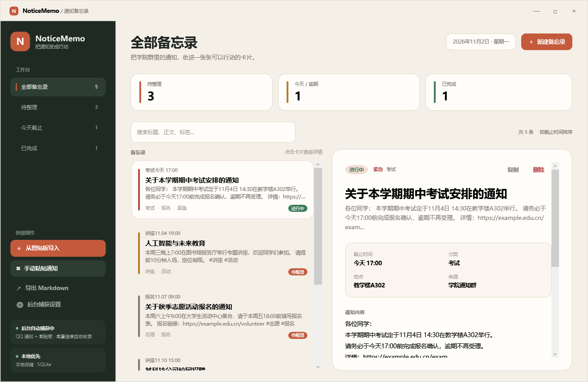
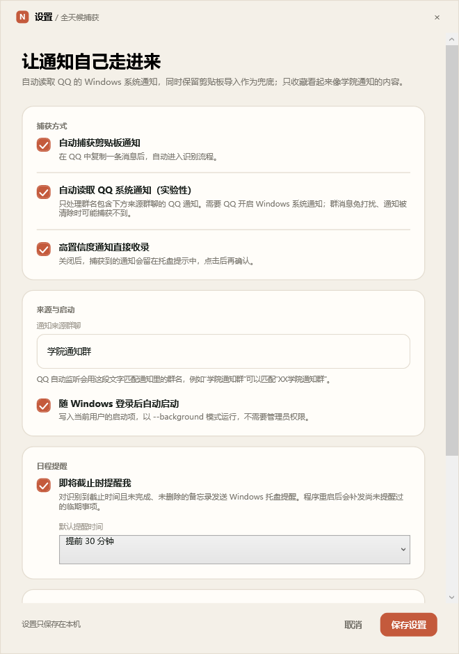

# NoticeMemo

> 把学院群里的通知，自动收进一张张可以行动的卡片。

NoticeMemo 是一个本地优先的 Windows 通知备忘录，针对“学院通知群消息很多，截止时间容易漏掉”的场景。它会从 Windows 通知中心读取 QQ 已经展示的群通知，也保留剪贴板导入作为兜底；识别出标题、截止时间、地点、分类、标签和链接后，保存成可搜索、可勾选、可提醒的备忘录。



## v0.3.0

这一版补上自动来源和到期提醒：

- 新增 QQ 系统通知监听：读取 Windows 通知中心里 QQ 已展示的通知
- 只处理群名包含“来源群聊”关键词的 QQ 群，普通私聊和其他群会被过滤
- 保留剪贴板监听，作为 QQ 未生成系统通知时的兜底
- 用标题、日期、行动词、链接等信号过滤普通聊天和代码片段
- 高置信度通知自动收录；其余候选进入托盘待确认队列
- 新增日程提醒：按截止时间提前提醒，完成后停止，重启后补发未提醒事项
- 提醒状态写入本地数据库，避免重复弹出
- 系统托盘常驻，关闭主窗口后继续运行
- 可选随 Windows 登录自动后台启动
- 单实例运行，重复双击会唤醒已有窗口
- 设置持久保存，可暂停捕获、关闭提示或修改来源群聊
- 保留手动导入、搜索筛选、完成状态、SQLite/JSON 存储和 Markdown 导出



## 快速开始

1. 从 GitHub Releases 下载 `NoticeMemo.exe`，或运行本地发布产物 `outputs\NoticeMemo-win-x64\NoticeMemo.exe`。
2. 双击启动。程序目前未做代码签名，Windows SmartScreen 可能提示“未知发布者”，请核对文件来源后选择“更多信息 → 仍要运行”。
3. 首次启用 QQ 自动监听时，允许 Windows 的通知读取权限。
4. 打开“后台捕获设置”，把来源群聊改成学院通知群名称中的稳定关键词，例如 `学院通知群`。
5. 确认 QQ 已开启 Windows 系统通知。新通知会由 NoticeMemo 自动判断，高置信度内容直接进入“待整理”。
6. 如果 QQ 没有生成系统通知，可以在群里复制通知；剪贴板链路仍然可用。
7. 关闭主窗口只会隐藏到托盘。需要完全退出时，使用托盘菜单中的“退出 NoticeMemo”。

第一次使用建议打开“后台捕获设置”，确认来源群聊、自动收录策略和开机启动选项。

## 全天候捕获：能做到什么

当前版本有两条捕获链路：

```text
QQ 收到消息 → QQ 展示 Windows 系统通知 → Windows 通知中心
             → NoticeMemo 读取（仅 QQ、仅匹配来源群聊）
             → 过滤与解析 → 本地备忘录 → 到期提醒

QQ 消息 → 人工复制 → Windows 剪贴板 → NoticeMemo（兜底）
```

- 登录 Windows 后，程序可以常驻托盘并持续运行
- 睡眠/唤醒后继续监听，无需重新启动
- 在 QQ 生成系统通知后自动读取，无需查看或复制消息
- 高置信度内容自动入库，较低置信度内容排队等待确认
- 开启“随 Windows 登录后自动启动”后，重启电脑也会回到后台
- 对识别到截止时间的未完成备忘录，在截止前发送托盘提醒

```text
自动监听不是“全量保证”。以下情况仍可能漏消息：

- QQ 未运行、未登录，或关闭了 Windows 系统通知
- 群消息设置了免打扰，或 Windows 专注助手/勿扰模式压制了通知
- QQ 只更新了应用内红点，没有生成 Windows Toast
- 通知在 NoticeMemo 读取前被手动清除，或系统未把它保留在通知中心
- 群名与“来源群聊”关键词不匹配
- NoticeMemo 被完全退出，或电脑处于关机/睡眠且系统未恢复监听

因此剪贴板入口保留为兜底；它不会在无人查看 QQ 时发现消息，但可以处理系统通知缺失的情况。

## 为什么不直接监听 QQ

当前版本读取的是 Windows 公开的通知中心数据，不是 QQ 内部聊天缓存。直接读取普通 QQ 群的全部消息，需要越过应用边界，当前版本有意不这么做：

- 该群不是使用者创建或管理的群，读取实时消息或历史记录需要群主/管理员的明确授权。
- 第三方 QQ 协议、注入客户端、读取本地聊天数据库或模拟点击存在账号风控、隐私泄露和违反平台规则的风险。
- QQ 官方机器人是合规方向，但机器人能否进群、能收到哪些群事件，取决于平台开放能力和群管理员的授权设置；普通成员不能自行把机器人变成“全群监听器”。
- 即使接入官方机器人，也不等于可以稳定获得群内所有消息，仍应以实际权限和平台规则为准。
- Windows 通知中心只保留 QQ 已经生成并尚未清理的 Toast，不包含 QQ 内部完整聊天历史。

因此当前版本不读取 QQ 窗口、聊天数据库或网络协议；只处理 QQ 主动交给 Windows 的通知，以及用户主动复制的文本。更完整的路线比较见 [QQ 监听边界说明](docs/qq-listening.md)。

## 自动收录规则

后台捕获不是“来什么就存什么”。无论是 QQ 系统通知还是剪贴板文本，过滤器都会综合判断：

- `【...】` 群公告标题、`@全体成员`、首行“通知/公告/安排”等结构
- 能否解析出中文日期、相对日期或截止时间
- 是否包含“报名、截止、提交、地点、会议、讲座、考试”等行动词
- 是否有多行正文、链接、称呼等通知特征

得分低的内容会被忽略；高置信度内容默认自动保存；中等置信度内容进入托盘待确认队列。待确认队列只保存在当前进程内，完全退出程序后不会保留。

可在设置中关闭“高置信度通知直接收录”，让所有候选都先经过确认。

## 日程与提醒

解析器识别到截止时间后，会在本地数据库里保存 `DueAt`。提醒服务每 30 秒检查一次未完成事项，并按设置提前发送 Windows 托盘提醒：

- 默认提前 30 分钟；可在设置中改为截止时、10 分钟、1 小时、2 小时或 1 天
- 提醒后会写入 `ReminderSentAt`，程序重启不会重复弹出同一条提醒
- 程序启动时会补发已经进入提醒窗口、但尚未提醒过的事项
- 标记完成后不再提醒；没有识别到截止时间的备忘录不会生成时间提醒
- 托盘气泡被关闭时不会静默标记为“已提醒”，重新开启后仍有机会收到

## 快捷键

| 快捷键 | 功能 |
| --- | --- |
| `Ctrl+N` | 新建/手动粘贴通知 |
| `Ctrl+Shift+V` | 立即从剪贴板导入 |
| `Ctrl+E` | 导出全部 Markdown |
| `Ctrl+F` | 搜索备忘录 |

## 数据与隐私

- 主数据库：`%LOCALAPPDATA%\NoticeMemo\noticememo.db`
- JSON 回退文件：`%LOCALAPPDATA%\NoticeMemo\noticememo.json`
- 设置文件：`%LOCALAPPDATA%\NoticeMemo\settings.json`
- Markdown 导出：`%USERPROFILE%\Documents\NoticeMemo\Exports`
- 演示数据：系统临时目录下的独立 `NoticeMemoDemo` 文件夹

所有通知、提醒状态和设置默认只保存在本机，不上传服务器。QQ 系统通知只在内存中读取，先按 QQ 应用和来源群名过滤，再进入本地规则判断；未达到通知阈值的文本不会保存。剪贴板内容同样只做本地规则判断。需要处理敏感内容时，可先在托盘菜单中暂停自动捕获。

## 命令行

```powershell
# 后台启动，适用于开机启动或脚本
.\NoticeMemo.exe --background

# 使用独立数据目录，适合便携运行和测试
.\NoticeMemo.exe --data-dir .\local-data

# 唤醒已运行的实例后退出，可用于脚本
.\NoticeMemo.exe

# 通知已运行的后台实例干净退出
.\NoticeMemo.exe --exit

# 使用临时数据展示界面
.\NoticeMemo.exe --demo
```

## 构建与测试

环境要求：Windows 10/11 x64、[.NET 10 SDK](https://dotnet.microsoft.com/download)。

仓库根目录的 `NuGet.Config` 为离线开发保留了空包源，联网构建时请显式使用公开配置：

```powershell
dotnet restore NoticeMemo.slnx --configfile .github\NuGet.Config --disable-parallel -m:1
dotnet build NoticeMemo.slnx -c Release --no-restore -m:1
dotnet run --project tests\NoticeMemo.Core.Tests\NoticeMemo.Core.Tests.csproj -c Release --no-build --no-restore
```

生成自包含单文件 exe：

```powershell
.\scripts\publish-win-x64.ps1
```

离线环境或自定义包源可传入配置：

```powershell
.\scripts\publish-win-x64.ps1 -NuGetConfig .\work\NuGet.local.config
```

产物位于 `outputs\NoticeMemo-win-x64\NoticeMemo.exe`。`.gitignore` 默认排除构建目录、`outputs`、`work` 和二进制文件；建议将 exe 附加到 GitHub Releases，而不是直接提交进仓库。

## 项目结构

```text
src/
  NoticeMemo.App/      WPF 界面、托盘、QQ 通知监听、日程提醒、剪贴板与后台协调
  NoticeMemo.Core/     通知解析、捕获过滤、模型、SQLite/JSON 存储、Markdown 导出
tests/
  NoticeMemo.Core.Tests/  无外部依赖的控制台测试运行器
scripts/
  publish-win-x64.ps1  Windows 单文件发布脚本
docs/
  qq-listening.md      QQ 自动监听路线与合规边界
```

## 更新记录

### v0.3.0

- 新增 QQ 系统通知监听和来源群聊过滤
- 新增日程提醒、提前时间设置、启动补发与提醒去重持久化
- SQLite 自动迁移 `reminder_sent_at` 字段，兼容 v0.2.0 数据
- 保留剪贴板兜底，补充 QQ 系统通知边界说明
- 核心测试扩展到 12 项，并完成通知监听与提醒链路的真实环境验证

### v0.2.0

- 新增后台剪贴板捕获、通知置信度过滤和托盘待确认队列
- 新增托盘常驻、单实例、唤醒和干净退出
- 新增设置持久化、暂停捕获、开机后台启动和气泡提示开关
- 新增 `--background`、`--data-dir`、`--exit` 命令参数
- 修复切换到“已完成/今天截止”筛选后，新导入备忘录不立即显示的问题
- 核心测试扩展到 10 项

### v0.1.0

- 完成通知解析、手动/剪贴板导入、搜索筛选、完成状态与 Markdown 导出
- 使用 SQLite 本地存储，系统 SQLite 不可用时自动回退到 JSON
- 提供自包含单文件 Windows x64 发布

## 后续方向

- 可选持久化待确认队列，避免程序退出时丢失候选
- 更稳定的中文日期、会场与报名规则
- 在群主或管理员明确授权后，评估官方 QQ 机器人适配层
- 持久化待确认队列和通知处理游标，避免清理通知后重读
- 安装包、代码签名和自动更新

## License

暂未选择开源许可证。若计划公开发布，请先补充 `LICENSE`；在此之前保留所有权利。
